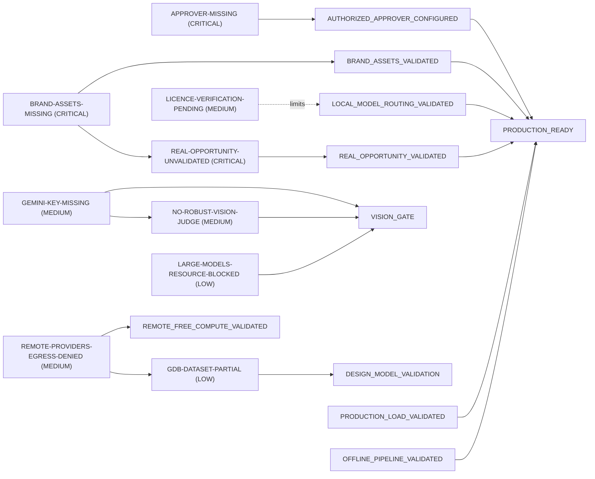

# Production blockers

_Generated 2026-11-03 17:15 UTC by `apex-one reports` at commit `17c6ca3` from measured artifacts._

Authoritative source: `config/production_blockers.yaml`; the acceptance rule is `config/production_acceptance.yaml`. Status comes from a live probe (`apex_one/lab/blockers.py`), never from hand-written text. PRODUCTION_READY is **NO** — unmet mandatory dimensions: ['BRAND_ASSETS_VALIDATED', 'AUTHORIZED_APPROVER_CONFIGURED', 'REAL_OPPORTUNITY_VALIDATED'].

`apex-one release check` → **BLOCKED**

* BRAND_ASSETS_VALIDATED: NO — next: apex-one brand import <folder>   (spec: BRAND_PACKAGE_INTAKE.md)
* AUTHORIZED_APPROVER_CONFIGURED: NO — next: apex-one auth add-approver "<full name>"   (spec: APPROVER_SETUP.md)
* REAL_OPPORTUNITY_VALIDATED: NO — next: apex-one evidence init <pack>   (spec: REAL_OPPORTUNITY_PILOT.md)

## Release blockers (production depends on these)

| blocker_id | status | severity | description | affected subsystem | owner | human action | external access | solvable offline | exact unblock condition | next executable action | probe evidence |
|---|---|---|---|---|---|---|---|---|---|---|---|
| APPROVER-MISSING | **OPEN** | CRITICAL | No release approver is registered, so no release decision can be authenticated. | release / human approval | APEX release owner (human) | yes | no | no | `apex-one auth list` shows at least one active release_approver AND `apex-one auth verify-ledger` reports the ledger intact | `apex-one auth add-approver "<full name>"   (see APPROVER_SETUP.md)` | 0 active approver(s); ledger intact |
| BRAND-ASSETS-MISSING | **OPEN** | CRITICAL | Original APEX brand package (logo, logo-on-dark, robot, brand.yaml with palette, fonts, font licences, usage constraints, checksums) is not installed; only bundled placeholders exist. | release / Brand Production Gate | APEX brand owner (human) | yes | no | no | `apex-one brand validate` prints VALID (every required asset present, vector, on-palette, not a placeholder, checksums match, fingerprint recorded) | `assemble the package per BRAND_PACKAGE_INTAKE.md; apex-one brand import <folder> --dry-run; then apex-one brand import <folder>` | apex-one brand validate → INCOMPLETE: logo: MISSING — logo.svg not found; logo_on_dark: MISSING — logo-on-dark.svg not found; robot: MISSING — robot.svg not found |
| REAL-OPPORTUNITY-UNVALIDATED | **OPEN** | CRITICAL | No real (non-synthetic) opportunity has reached RELEASE_CANDIDATE. Official sites are egress-denied here; the CNCF LFX 2027 job stopped AWAITING_HUMAN (single-source deadline; funding and eligibility pages unreachable). | research / Fact Lock / release | APEX editor (human) supplying authoritative evidence | yes | yes | no | a non-synthetic job built from an evidence pack (`apex-one evidence run <pack>`) reaches RELEASE_CANDIDATE with every critical fact locked from ≥ 2 sources or human-confirmed | `follow REAL_OPPORTUNITY_PILOT.md: apex-one evidence init <pack-dir>; save the official pages/PDFs into it; apex-one evidence check <pack-dir>` | no non-synthetic job has reached RELEASE_CANDIDATE |
| PRODUCTION-LOAD-UNVALIDATED | **RESOLVED** | HIGH | PRODUCTION_MODE has not been exercised under concurrent load with a real model and real renders. | compute scheduler / job queue | Claude (autonomous) | no | no | yes | artifacts/bench/load_test/report.json: every scenario PASS in PRODUCTION_MODE with the production text model (Qwen3-VL 4B) and real Chromium renders, zero OOM, zero swap, failure rate within the scenario's bound | `python -m apex_one.lab.load_test --model qwen3-vl-4b-q4kxl` | load test PASS (model qwen3-vl-4b-q4kxl, real model: True) |

## EXPERIMENTAL / OPTIONAL IMPROVEMENT (never a production blocker)

| blocker_id | status | severity | description | affected subsystem | owner | human action | external access | solvable offline | exact unblock condition | next executable action | probe evidence |
|---|---|---|---|---|---|---|---|---|---|---|---|
| GEMINI-KEY-MISSING | **OPEN** | MEDIUM | GEMINI_API_KEY is not set; Gemini (free tier) is the only legal $0 remote vision route that answers from this container. | vision gate / remote free compute | account owner (human) | yes | yes | no | GEMINI_API_KEY present, a free_tier_no_billing attestation recorded, AND `apex-one vision validate-gemini` passes its live test (the calibration outcome itself may be UNQUALIFIED — that still unblocks) | `apex-one vision validate-gemini  (prints BLOCKED_NO_KEY until the key exists)` | GEMINI_API_KEY not set |
| LICENCE-VERIFICATION-PENDING | **OPEN** | MEDIUM | Gemma 3 (4B, 12B) and Nemotron 3 Nano are DECLARED_BUT_UNVERIFIED; gpt-oss 20B is UNKNOWN. They may be evaluated, never deployed; routes they lead are EVALUATION_ONLY. | model routing / licence registry | APEX legal / owner (human) | yes | no | no | each pending licence (lic-gemma, lic-gemma3-12b, lic-nvidia-nemotron-nano, lic-gpt-oss) recorded by a named human with `apex-one license verify` as PRODUCTION_ALLOWED or BLOCKED (BLOCKED also resolves the blocker: the decision is what is missing) | `read docs/evidence/licence_review_pack.md, then decide per model` | awaiting a human decision: ['lic-gemma', 'lic-gemma3-12b', 'lic-nvidia-nemotron-nano', 'lic-gpt-oss'] |
| NO-ROBUST-VISION-JUDGE | **OPEN** | MEDIUM | No ROBUSTLY_CALIBRATED vision judge exists; absolute visual quality is NOT_MEASURED and the only judge (Qwen3-VL 8B) is canonical-640-only and advisory. | vision gate | Claude (runs calibration) once a candidate is reachable | no | yes | no | a judge passes absolute ≥ 4/5, pairwise ≥ 4/5, position bias ≤ 0.2, legibility and repeat stability at every width (ROBUSTLY_CALIBRATED) | `apex-one vision validate-gemini (after GEMINI-KEY-MISSING), or a ≥ 24 GB machine for larger local judges` | ROBUSTLY_CALIBRATED judges: none |
| REMOTE-PROVIDERS-EGRESS-DENIED | **OPEN** | MEDIUM | The environment's egress proxy denies NVIDIA NIM, Groq, OpenRouter, Cloudflare Workers AI, Hugging Face, Mistral and Together (CONNECT 403). | remote free compute / design specialists / GDB dataset | environment administrator (human) | yes | yes | no | at least one remote $0 provider LIVE_TESTED by `apex-one providers live-test` with a correct structured answer | `apex-one providers live-test` | remote providers LIVE_TESTED: none (cloudflare=NETWORK_BLOCKED, gemini=CREDENTIALS_REQUIRED, groq=NETWORK_BLOCKED, huggingface=NETWORK_BLOCKED, llamacpp=LIVE_FAILED, llamacpp_local=LIVE_TESTED, llamacpp_local=UNKNOWN, mlx=LIVE_FAILED, nvidia_nim=NETWORK_BLOCKED, ollama=LIVE_FAILED, openrouter=NETWORK_BLOCKED, sglang=CREDENTIALS_REQUIRED, vllm=CREDENTIALS_REQUIRED) |
| GDB-DATASET-PARTIAL | **OPEN** | LOW | GraphicDesignBench runs 6 of 39 tasks offline (n=2); the full dataset is on huggingface.co (egress-denied). | design model validation | environment administrator (human) for network access | no | yes | no | huggingface.co reachable and every GDB task runs at n ≥ 20 (UNSUPPORTED tasks stay UNSUPPORTED, never failures) | `after huggingface.co is allowed: re-run the queue's gdb steps` | 6/39 tasks runnable offline (n=2); full dataset on huggingface.co |
| LARGE-MODELS-RESOURCE-BLOCKED | **OPEN** | LOW | Qwen3-VL 8B Q8_K_XL (expected peak 21.0 GB) and gpt-oss 20B (21.1 GB) cannot be admitted on this 16 GB machine; they were not downloaded. | compute scheduler | environment owner (hardware) | no | no | no | a machine whose idle MemAvailable admits the expected peak + reserves + the evaluation headroom (≥ ~24 GB RAM) | `on such a machine: APEX_RETRY_BLOCKED=1 scripts/snapshot_run.sh <commit> scripts/validation_queue.py --max-steps 3` | RESOURCE_BLOCKED on this machine: ['gpt-oss-20b-mxfp4', 'qwen3-vl-8b-q8kxl'] |

## Blocker graph

Blockers → the maturity dimension each one holds open (dashed: limits capability, has a safe fallback, does not hold it open) → PRODUCTION_READY (mandatory dimensions only).

## Maturity matrix (independent dimensions)

| dimension | status | required for production | why | evidence | open blockers |
|---|---|---|---|---|---|
| BRAND_ASSETS_VALIDATED | **NO** | yes | no FINAL artifact may carry placeholder branding | apex-one brand validate → INCOMPLETE: logo: MISSING — logo.svg not found; logo_on_dark: MISSING — logo-on-dark.svg not found; robot: MISSING — robot.svg not found | BRAND-ASSETS-MISSING |
| AUTHORIZED_APPROVER_CONFIGURED | **NO** | yes | a release needs a token-authenticated approver whose decision is bound to the artifact hash | 0 active approver(s); ledger intact | APPROVER-MISSING |
| REAL_OPPORTUNITY_VALIDATED | **NO** | yes | one real guide must reach RELEASE_CANDIDATE from authoritative evidence | no non-synthetic job has reached RELEASE_CANDIDATE | REAL-OPPORTUNITY-UNVALIDATED |
| PRODUCTION_LOAD_VALIDATED | **YES** | yes | PRODUCTION_MODE must throttle, never OOM, under concurrent load | load test PASS (model qwen3-vl-4b-q4kxl, real model: True) | — |
| OFFLINE_PIPELINE_VALIDATED | **YES** | yes | golden ULTRA reaches the human gate with every quality target PASS | golden ULTRA: comprehension 98.9, rhythm 94.0, Arabic typography 100; tests/test_pipeline.py::test_golden_ultra_quality_never_regresses | — |
| LOCAL_MODEL_ROUTING_VALIDATED | **YES** | yes | every deployed model route rests on identical measurements and a verified licence | 9 production model routes, all on identical measurements with verified licences; EVALUATION_ONLY (native in production): ['editorial.write.egyptian_guide', 'editorial.write', 'editorial.critique'] | — |
| ARCHITECTURE_COMPLETE | **YES** | no | structural; already YES and covered by the test suite | state machine, $0 compute, research, editorial, design, QA, release, learning | — |
| DESIGN_MODEL_VALIDATION | **PARTIAL** | no | native APEX design is primary on every page type; model design is optional | GDB 6/39 tasks offline (n=2); native wins or ties every page type | GDB-DATASET-PARTIAL |
| VISION_GATE | **PARTIAL** | no | absolute visual quality is reported NOT_MEASURED on the release candidate and the human approver reviews the final PDF; no release decision depends on a model judge | robust judges none; canonical-only pairwise judges ['qwen3-vl-8b']; absolute visual quality NOT_MEASURED | GEMINI-KEY-MISSING, NO-ROBUST-VISION-JUDGE, LARGE-MODELS-RESOURCE-BLOCKED |
| REMOTE_FREE_COMPUTE_VALIDATED | **NO** | no | the $0 local route serves every production model task | remote providers LIVE_TESTED: none (cloudflare=NETWORK_BLOCKED, gemini=CREDENTIALS_REQUIRED, groq=NETWORK_BLOCKED, huggingface=NETWORK_BLOCKED, llamacpp=LIVE_FAILED, llamacpp_local=LIVE_TESTED, llamacpp_local=UNKNOWN, mlx=LIVE_FAILED, nvidia_nim=NETWORK_BLOCKED, ollama=LIVE_FAILED, openrouter=NETWORK_BLOCKED, sglang=CREDENTIALS_REQUIRED, vllm=CREDENTIALS_REQUIRED) | REMOTE-PROVIDERS-EGRESS-DENIED |
| PRODUCTION_READY | **NO** | yes | PRODUCTION_READY = YES iff every required dimension = YES (config/production_acceptance.yaml) | unmet mandatory dimensions: ['BRAND_ASSETS_VALIDATED', 'AUTHORIZED_APPROVER_CONFIGURED', 'REAL_OPPORTUNITY_VALIDATED'] | BRAND_ASSETS_VALIDATED, AUTHORIZED_APPROVER_CONFIGURED, REAL_OPPORTUNITY_VALIDATED |
